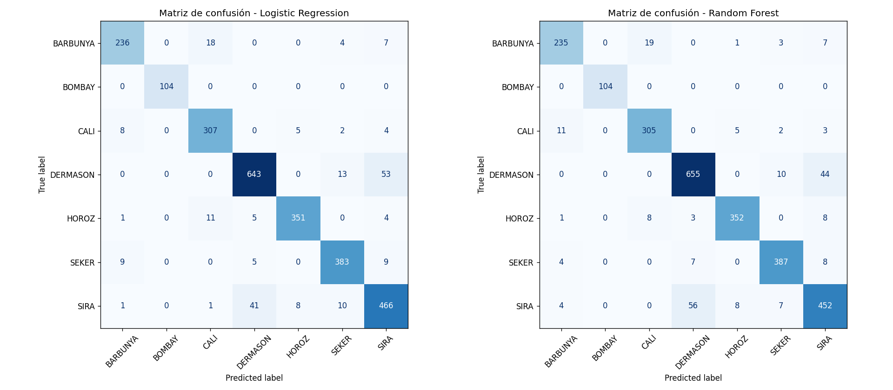
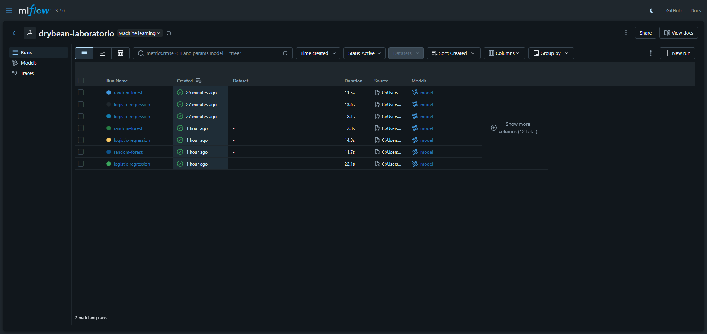

# Laboratorio de ML con datos reales — Dry Bean Dataset

**Clasificación de variedades de frijol seco aplicando CRISP-DM + TDSP + Scrum ML**

Universidad Autónoma de Occidente (UAO) · Gestión de Proyectos de IA

**Equipo:** Osvaldo Emilio Marin · Nilson Jacobo Gonzales · Edgar Adrián Ortiz · Juan Andrés Ruiz Muñoz

Dataset: [Dry Bean Dataset — UCI Machine Learning Repository (id 602)](https://archive.ics.uci.edu/dataset/602/dry+bean+dataset) · 13.611 granos · 16 variables geométricas · 7 variedades.

---

## Problema de negocio

Una empresa agrícola quiere automatizar la clasificación de granos de frijol para mejorar su control de calidad. El modelo predice la variedad (`Class`: BARBUNYA, BOMBAY, CALI, DERMASON, HOROZ, SEKER, SIRA) a partir de características de forma y tamaño extraídas de imágenes.

## Resultados

| Modelo | Accuracy (test) | F1 macro (test) | F1 macro (CV 5 folds) |
|---|---|---|---|
| Logistic Regression (baseline) | **0,9195** | **0,9306** | **0,936 ± 0,007** |
| Random Forest (200 árboles, balanced) | 0,9192 | 0,9303 | 0,935 ± 0,004 |
| Random Forest + GridSearchCV | 0,9181 | 0,9299 | 0,936 (CV 3) |

**Decisión:** los dos modelos presentan resultados próximos en este experimento; no se realizó una prueba de equivalencia estadística. Según el criterio del laboratorio (*preferir el modelo más simple si el desempeño es parecido*), se **recomienda la regresión logística** para la demo. Ambos modelos quedan guardados.

**Hallazgo principal:** en el test histórico del Random Forest, **SIRA ↔ DERMASON** concentra el 44 % de los errores; también se confunden **BARBUNYA ↔ CALI**. BOMBAY alcanza F1 = 1 en ese test. El solapamiento geométrico sugiere explorar color y textura; estos experimentos no demuestran un techo de rendimiento ni descartan otros modelos.

<p align="center">
  
</p>

Reporte completo: [`docs/reporte_final.md`](docs/reporte_final.md)

## Estructura del proyecto (TDSP adaptado al laboratorio)

Se conserva la estructura solicitada en `Lab1.pdf` (p. 3) y `Plan_Equipos_ScrumML_DryBean.pdf` (p. 1). Las carpetas de API, dashboard, pruebas y despliegue amplían esa base. No es una copia literal de la plantilla histórica de Microsoft.

```
gestion-ia-laboratorio/
├── deploy/
│   ├── web/                  # Extensión opcional: FastAPI, Streamlit, Docker y Compose
│   │   ├── main.py           # Entrada de Streamlit
│   │   ├── api/              # Contrato HTTP y carga del modelo
│   │   ├── dashboard/        # Vistas, barra lateral y cliente HTTP
│   │   ├── .streamlit/       # Tema y configuración
│   │   ├── Dockerfile        # Construcción de las dos imágenes
│   └── azure/                # Publicación opcional en nube
├── data/
│   ├── raw/                  # Datos originales sin modificar (Dry_Bean_Dataset.xlsx + descripción)
│   └── processed/            # Datos limpios (se generan al ejecutar)
├── notebooks/
│   └── 01_laboratorio_drybean.ipynb   # Notebook ejecutado: pasos 1–18 + extensiones + respuestas
├── outputs/
│   ├── models/               # Modelos entrenados (.joblib)
│   └── reports/              # Métricas (CSV/JSON), predicciones y figuras
├── src/
│   ├── config.py             # Rutas, semilla y constantes
│   ├── data.py               # Carga (UCI con respaldo local), calidad, limpieza, partición
│   ├── models.py             # Definición de baseline y Random Forest
│   ├── evaluate.py           # Métricas, matrices de confusión, errores frecuentes
│   ├── predict.py            # predict_bean_class() + CLI de predicción
│   └── laboratorio_drybean.py# Pipeline completo de extremo a extremo
├── tests/                    # Pruebas pytest (Definition of Done)
├── logs/                     # Resultados de predicción local (generados, fuera de Git)
├── docs/
│   ├── reporte_final.md      # Entregable 2: reporte CRISP-DM
│   └── scrum/                # Entregable 3: backlog, tablero, sprints, retrospectiva, DoD
├── main.py                   # Uso local: pipeline, predict, train, local, docker, test
├── docker-compose.yaml       # Arranque local de API y dashboard
├── docker-compose.dev.yaml   # Expone la API en localhost para desarrollo
├── requirements.txt
└── README.md
```

## Cómo reproducirlo

```bash
git clone https://github.com/jg-uao/gestion-ia-laboratorio.git
cd gestion-ia-laboratorio

python -m venv .venv
# Linux/Mac:           source .venv/bin/activate
# Windows PowerShell:  .venv\Scripts\Activate.ps1
pip install -r requirements.txt

# Para ejecutar el notebook con el entorno del proyecto:
python -m ipykernel install --user --name drybean-lab --display-name "Dry Bean (.venv)"
```

| Acción | Comando |
|---|---|
| Pipeline completo (datos → modelos → reportes) | `python main.py pipeline` |
| Pipeline + validación cruzada y GridSearchCV | `python main.py pipeline --extras` |
| Abrir el notebook | `jupyter notebook notebooks/01_laboratorio_drybean.ipynb` |
| Predecir con el modelo guardado | `python main.py predict` (tras `pipeline`; `--input` y `--n` opcionales) |
| Ejecutar las pruebas | `python main.py test` |

### MLOps local con MLflow

MLflow registra los experimentos; el entrenamiento sigue ejecutándose en Python, desde el pipeline o el notebook. El servidor se inicia en Docker con almacenamiento persistente local:

```powershell
docker compose --profile mlops up -d mlflow
.venv\Scripts\python.exe -m jupyter notebook notebooks/01_laboratorio_drybean.ipynb
```

Cada celda de entrenamiento del notebook indica directamente la dirección local de MLflow; no hace falta configurar una variable en PowerShell ni ejecutar previamente la celda de configuración para activar el seguimiento. Al terminar, la celda imprime el enlace del run. Abre **http://localhost:5000** y selecciona el experimento `drybean-laboratorio`. Se registran regresión logística y Random Forest por separado con parámetros, semilla, huella del archivo de datos, accuracy, F1 macro, reporte por clase, matriz de confusión y modelo con esquema de entrada. GridSearch se registra al ejecutar su celda. Los resultados que ya estaban guardados en el notebook no aparecen en MLflow hasta volver a ejecutarlo.

La captura corresponde a la primera verificación de seguimiento. En **Runs**, abre un run para ver sus parámetros, métricas y artefactos. En **Datasets** puedes consultar las particiones de entrenamiento y evaluación de los runs recientes, que incluyen sus huellas y la fuente utilizada.



La base de experimentos y los artefactos viven en el volumen Docker `drybean_mlflow_data`, fuera de Git. El archivo `logs/predictions.jsonl` registra predicciones locales y es distinto de los runs de entrenamiento en MLflow.

Si el editor pide elegir kernel, selecciona **Dry Bean (.venv)**. La primera celda imprime la ruta de Python; debe terminar en `.venv\\Scripts\\python.exe` en Windows. Un kernel llamado simplemente «Python (venv)» puede apuntar a otra instalación y carecer de las dependencias del proyecto.

**Entrenar, registrar y activar una versión.** Usa el ID de un run de regresión logística creado con el Excel versionado. Puedes obtenerlo del notebook, que usa ese Excel por defecto, o con el comando `train` de MLOps.

```powershell
.venv\Scripts\python.exe -m src.mlops train
$runId = Read-Host 'ID del run de regresión logística'
.venv\Scripts\python.exe -m src.mlops register --run-id $runId
.venv\Scripts\python.exe -m src.mlops promote
.venv\Scripts\python.exe main.py docker
.venv\Scripts\python.exe -m src.mlops status
Invoke-RestMethod http://127.0.0.1:8000/api/v1/model
```

`register` revisa las huellas de los datos y las métricas, y etiqueta la versión como `candidate` en MLflow Model Registry. `promote` valida las 16 variables, las siete clases, las probabilidades y un F1 macro mínimo de 0,90 sobre el holdout reproducible del Excel. Publica el artefacto validado en `outputs/models/mlops/releases/` y actualiza `champion`. FastAPI carga el artefacto local al iniciar y expone la versión del registro y el ID del run en `/api/v1/model`. Sin una promoción local, usa el modelo histórico incluido en el repositorio.

La API carga el modelo una vez por inicio. Si ya estaba levantada, reiníciala después de promover o revertir. En Docker, ejecuta `docker compose -f docker-compose.yaml -f docker-compose.dev.yaml restart api` y consulta `/health/ready`. Para revertir usa `.venv\Scripts\python.exe -m src.mlops rollback` y vuelve a iniciar la API. Para seleccionar una versión concreta usa `promote --version N`.

**Monitoreo local.** `.venv\Scripts\python.exe -m src.mlops monitor` genera `outputs/reports/mlops_monitor.json` con volumen, confianza y distribución de clases predichas de la versión activa. Con `monitor --csv RUTA` puedes comparar las 16 variables de un lote nuevo con el entrenamiento. Si el lote incluye la columna `Class`, calcula accuracy y F1 macro sobre esas etiquetas. Los umbrales del laboratorio son al menos 30 observaciones, una diferencia de 10 puntos porcentuales en la proporción de una clase, o un estadístico KS superior a 0,20 en una variable. Es un reporte bajo demanda. La promoción sigue siendo una decisión explícita y se puede repetir con el flujo anterior.

**Verificación local.** FastAPI en Docker sirvió la versión 4 de `drybean-classifier` entrenada en el notebook, revirtió a la versión 3 y volvió a la 4. La API identificó cada versión y predijo `SEKER` en los tres pasos. El holdout de la versión 4 obtuvo accuracy de **0,9192** y F1 macro de **0,9302**. Streamlit respondió por HTTP, pasaron **44 pruebas** y un lote simulado de 100 filas permitió comprobar el reporte de cambios en las variables y las métricas con etiquetas. Se registró además una búsqueda de hiperparámetros reducida como prueba de integración.

Para registrar toda la comparación desde el script, configura `MLFLOW_TRACKING_URI` para `main.py pipeline`. Ese pipeline intenta UCI y tiene respaldo local, mientras que `src.mlops train` siempre usa el Excel versionado para generar un candidato. Detén MLflow con `docker compose --profile mlops stop mlflow` para conservar su volumen.

Sin conexión a internet, la carga usa automáticamente la copia local `data/raw/Dry_Bean_Dataset.xlsx`. Utiliza **Python 3.12**; `requirements.txt` reúne las dependencias directas fijadas del laboratorio, API, dashboard y pruebas. La semilla `random_state=42` permite repetir la partición con los mismos datos y entorno. El artefacto web se preparó con Python 3.12.5 y comprueba versiones de inferencia en su manifiesto. Los modelos históricos pueden emitir advertencias si se cargan con otra versión de scikit-learn.

`python main.py predict` y las predicciones de la API local, con o sin Compose, agregan una línea JSON por resultado en `logs/predictions.jsonl`. Cada línea registra fecha UTC, origen, identificador del lote, índice, clase, confianza y versión del modelo cuando está disponible. Las medidas de entrada quedan fuera del archivo y el log se excluye de Git.

## Dashboard y despliegue con Docker

La extensión en `deploy/web/` es opcional para reproducir el laboratorio. **FastAPI** sirve las predicciones y **Streamlit** permite ingresar medidas, cargar CSV y consultar la evaluación del modelo activo. El Dockerfile construye una imagen por servicio; Compose las inicia y conecta. `deploy/web/main.py` es la entrada de Streamlit, no construye imágenes. Las dos imágenes de esta estructura ya se construyeron localmente y sus servicios pasaron las sondas de salud.

`main.py` en la raíz concentra el uso local: `python main.py pipeline`, `python main.py predict`, `python main.py train` (reentrena el modelo del servicio), `python main.py local` (API y dashboard sin Docker), `python main.py docker` / `python main.py docker --down` (Compose con la API expuesta en `localhost:8000`) y `python main.py test`. Azure no usa este archivo; se despliega con `deploy/azure/Deploy.ps1`.

Equivalente manual con Docker Desktop en modo Linux, desde la raíz:

```powershell
docker compose up --build -d --wait
```

Abrir **http://localhost:8501**. Para publicar también la API en localhost y usar PowerShell o Swagger:

```powershell
docker compose -f docker-compose.yaml -f docker-compose.dev.yaml up --build -d --wait
```

El CSV de la interfaz debe ser UTF-8, con las 16 columnas de medidas; `Class` es opcional. Se aceptan hasta 1.000 filas y 2 MiB. Los resultados se pueden descargar y, si el archivo tiene etiquetas reales, la interfaz muestra los aciertos de ese lote por separado. Para detener los contenedores: `docker compose down`.

El alcance vigente es local. La [guía de Azure](deploy/azure/README.md) conserva el historial de la publicación de noviembre de 2026.

Para iniciar la API en PowerShell con Python 3.12:

```powershell
python -m venv .venv
.venv\Scripts\python.exe -m pip install -r requirements.txt
.venv\Scripts\python.exe -m uvicorn deploy.web.api.main:app --host 127.0.0.1 --port 8000
```

En otra terminal, el dashboard puede iniciarse sin Docker con `.venv\Scripts\python.exe -m streamlit run deploy/web/main.py`. Documentación interactiva de la API: `http://127.0.0.1:8000/docs`. Los endpoints principales son `GET /health/ready`, `GET /api/v1/model` y `POST /api/v1/predict`, que recibe `{"instances": [{...16 medidas...}]}`. Para probarlo en PowerShell:

```powershell
$beanRequest = Get-Content outputs/models/serving/example_request.json -Raw
Invoke-RestMethod -Method Post -Uri http://127.0.0.1:8000/api/v1/predict -ContentType application/json -Body $beanRequest
```

El artefacto web está en `outputs/models/serving/`, separado de los modelos históricos; su evaluación es accuracy **0,9192** y F1 macro **0,9302**. Se puede regenerar con `.venv\Scripts\python.exe -m deploy.web.prepare_serving_model`. Pruebas disponibles: `.venv\Scripts\python.exe -m pytest -q`.

## Metodologías

### CRISP-DM

| Fase | Dónde |
|---|---|
| 1. Comprensión del negocio | Notebook (inicio), reporte §1 |
| 2. Comprensión de los datos | Pasos 3–6: forma, tipos, outliers, nulos, duplicados, balance de clases |
| 3. Preparación | Pasos 5, 7, 8: eliminación de 68 duplicados, partición 80/20 estratificada, escalado en `Pipeline` |
| 4. Modelado | Pasos 9 y 11: Logistic Regression y Random Forest |
| 5. Evaluación | Pasos 10, 12–15 + validación cruzada y GridSearch |
| 6. Despliegue | Pasos 16–18: `joblib`, `predict_bean_class`, CLI; extensión opcional FastAPI, Streamlit y Docker en `deploy/web/`, Azure en `deploy/azure/` |

### TDSP

Adaptación académica de TDSP: estructura prescrita por el laboratorio, código reutilizable en `src/`, datos crudos separados, semilla documentada, modelos y reportes históricos en Git y pruebas automáticas. La extensión web añade un manifiesto con huellas de artefactos y dependencias de inferencia fijadas.

### Scrum ML

| Rol | Integrante | Responsabilidades |
|---|---|---|
| Product Owner | Edgar Adrian Ortiz | Define objetivos, prioriza el backlog, valida la entrega final |
| Scrum Master | Osvaldo Emilio Marin | Coordina reuniones, mantiene el tablero, README y flujo Git |
| Data Engineer / Analyst | Nilson Jacobo Gonzales | Descarga, calidad, limpieza y EDA |
| ML Engineer | Juan Andrés Ruiz Muñoz | Entrenamiento, evaluación y despliegue del modelo |

Equipo de **4 integrantes**, según la distribución de entregables compartida. Data Engineer y ML Engineer son especialidades del equipo de desarrollo; Scrum distingue las responsabilidades de Product Owner, Scrum Master y Developers. «Scrum ML» es la adaptación usada en el laboratorio.

- Sprints 1–3 — laboratorio académico · Sprints 4–6 — extensión opcional de API, dashboard y Azure
- [Guía de la evidencia Scrum ML](docs/scrum/README.md): backlog, tablero, sprints, retrospectiva y Definition of Done.

### Flujo de trabajo en GitHub

1. Una rama por historia: `git checkout -b feature/<historia>`
2. Commits con el ID del backlog: `git commit -m "PB-03: baseline logistic regression"`
3. `git push origin feature/<historia>` → Pull Request → revisión de un compañero → merge a `main`
4. Antes de empezar: `git pull origin main`

## Referencia

Koklu, M. & Ozkan, I. A. (2020). *Multiclass classification of dry beans using computer vision and machine learning techniques.* Computers and Electronics in Agriculture, 174, 105507. Dataset: UCI Machine Learning Repository, Dry Bean Dataset (id 602).
